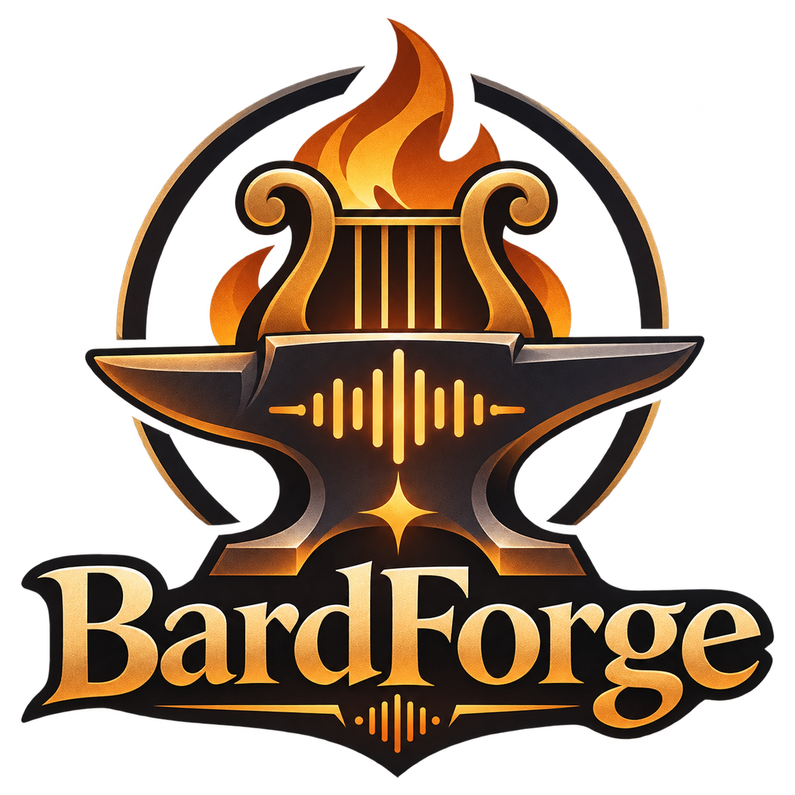

# BardForge

**Звук, который помогает рассказывать истории.** Соберите шум дождя, музыку и эффекты в сцену и управляйте атмосферой одним приложением.

## Что такое BardForge

BardForge — модульная аудиоплатформа. Сегодня её основа — локальный микшер для мастеров настольных RPG, D&D и других игровых систем. Он подходит для звукового сопровождения встреч и историй независимо от правил игры. Дальнейшее развитие охватывает музыкальные инструменты, голос, AI и игровые интеграции.

Основное приложение **бесплатно**, программный код открыт по **MIT**. Сейчас доступна development-реализация для Windows x64; публичного стабильного EXE ещё нет. [Как установить и попробовать](https://github.com/BardForge/bardforge/blob/dev/docs/getting-started/installation.md).

## Возможности и готовность

| Работает в development                                                                                  | Эксперимент                                                                                     | Планируется                                                                                |
| ------------------------------------------------------------------------------------------------------- | ----------------------------------------------------------------------------------------------- | ------------------------------------------------------------------------------------------ |
| Локальный импорт, микшер, вложенные категории, сцены, звуковая панель, последовательности, RU/EN и темы | Отдельная Foundry-интеграция без готовой панели отправителя Studio и проверки удалённого игрока | Plugin SDK, каталог модулей, Voice Changer, AI Providers, Music Studio и другие интеграции |

Core должен оставаться полезным без модулей: импортировать аудио, создавать дорожки и воспроизводить сцены. Дополнения расширяют его возможности, а не заменяют обязательный аудиодвижок.

## Как это работает

1. Импортируйте свои записи или откройте встроенную демосцену.
2. Разложите звук по категориям, настройте уровни и зацикливание.
3. Сохраните сцену, запускайте фон и эффекты во время игры.
4. Переносите сцену вместе с аудио через `.bardforge`.

[Пошаговый «Ночной лес»](https://github.com/BardForge/bardforge/blob/dev/docs/getting-started/first-scene.md) · [руководства пользователя](https://github.com/BardForge/bardforge/blob/dev/docs/README.md).

## Скриншоты

Текущий интерфейс `0.1.0-dev.3` в браузерном просмотре, встроенные синтезированные звуки. Это не макет будущих функций. [English interface](https://github.com/BardForge/bardforge/blob/dev/docs/images/studio-en.png).

## Официальные репозитории

- [BardForge Studio](https://github.com/BardForge/bardforge) — Core и desktop-приложение. Основной репозиторий организации BardForge.
- [bardforge-foundry](https://github.com/BardForge/bardforge-foundry) — основной репозиторий отдельной экспериментальной интеграции Foundry.
- [.github](https://github.com/BardForge/.github) — профиль, правила участия и общие материалы сообщества.

## План разработки

Ближайший ориентир — **v0.1.0 Audio MVP** и проверки, необходимые для стабильного выпуска. Затем — улучшения микшера/пресетов и рабочих пространств. AI, голосовые и музыкальные инструменты — дальнейшие направления без обещанных дат.

[Roadmap](https://github.com/BardForge/bardforge/blob/dev/docs/roadmap.md) · [единая доска BardForge Development](https://github.com/orgs/BardForge/projects/1).

## Как поддержать проект

Сообщайте о воспроизводимых ошибках, тестируйте development-сборки на своих тестовых данных, улучшайте руководства и переводы, предлагайте небольшие PR. Идеи и вопросы — в [Discussions](https://github.com/orgs/BardForge/discussions), конкретные задачи — в [Issues](https://github.com/BardForge/bardforge/issues). Официальные платёжные страницы и сбор пожертвований не объявлены.

[Правила участия](https://github.com/BardForge/.github/blob/dev/CONTRIBUTING.md). Внешние участники используют fork и PR в `dev`; это не предоставляет права записи. `main` и релизы требуют решения владельца.

## Лицензия и бренд

Код и техническая текстовая документация — [MIT](https://github.com/BardForge/.github/blob/dev/LICENSE), с сохранением авторских уведомлений. Допускаются бесплатные и коммерческие модули и интеграции. Логотип, название и фирменные материалы рассматриваются отдельно; MIT на код не разрешает выступать от имени BardForge. Сторонние зависимости, модели и аудио сохраняют свои условия. [Границы лицензии](https://github.com/BardForge/.github/blob/dev/LICENSING.md).

## AI-Assisted Development

BardForge is developed with assistance from artificial intelligence tools. AI may contribute to code, documentation, testing, and technical design. All contributions remain subject to human review, validation, and applicable licensing requirements.
